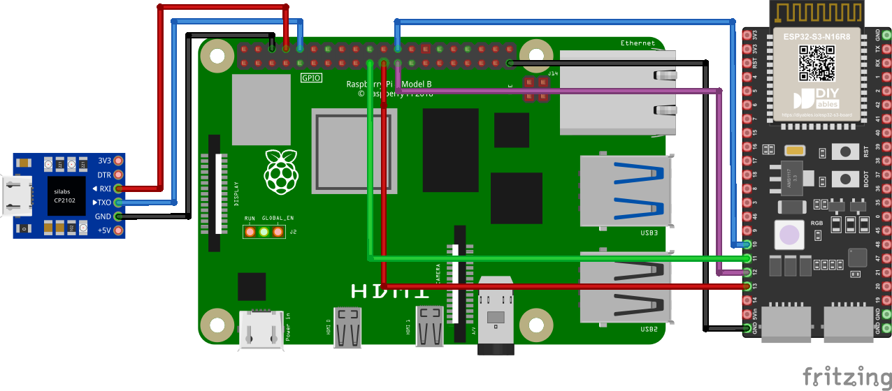
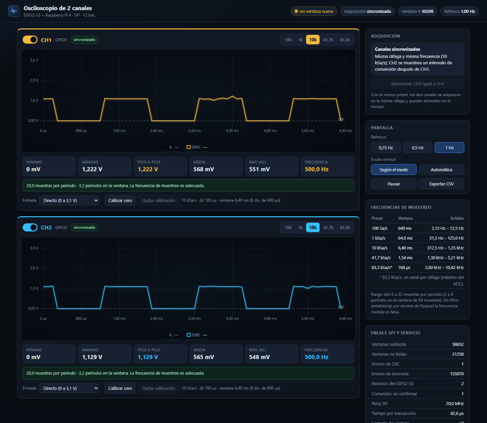

# Instalación, configuración y uso — Osciloscopio

Guía completa para poner en marcha el sistema desde cero: conexiones, firmware del ESP32-S3, software de la Raspberry Pi 4 y uso del dashboard. Para pruebas manuales con hoja de registro, ver el [Documento 7](Documentos/Latex/07_Guia_operacion_y_pruebas_manuales.tex).

**Contenido**

1. [Hardware y conexiones](#1-hardware-y-conexiones)
2. [Firmware del ESP32-S3 (Zephyr, desde WSL)](#2-firmware-del-esp32-s3-zephyr-desde-wsl)
3. [Software de la Raspberry Pi 4](#3-software-de-la-raspberry-pi-4)
4. [Puesta en marcha](#4-puesta-en-marcha)
5. [Uso del dashboard](#5-uso-del-dashboard)
6. [Consola UART de la Raspberry Pi](#6-consola-uart-de-la-raspberry-pi)
7. [Referencia de comandos](#7-referencia-de-comandos)
8. [Solución de problemas](#8-solución-de-problemas)

---

## 1. Hardware y conexiones

| Componente | Detalle |
|---|---|
| Microcontrolador | ESP32-S3-DevKitC-1, módulo ESP32-S3-WROOM-1 **N8R2** (8 MB flash, 2 MB PSRAM), puente USB-UART CP2102N |
| SBC | Raspberry Pi 4 Model B, Raspberry Pi OS (Debian 13), kernel 6.18 |
| Consola de la Raspberry Pi (opcional) | Adaptador USB-UART CP2102 |
| PC de desarrollo | Windows 11 + WSL (Ubuntu) con Zephyr 4.5 y `usbipd-win` |



Pines de la DevKitC-1 contados desde arriba, con los conectores USB hacia abajo:

| Señal | ESP32-S3 | Posición en la DevKitC-1 | Raspberry Pi 4 (pin físico) |
|---|---|---|---|
| CS | GPIO10 | izquierda, pin 16 | GPIO8 / CE0 (24) |
| MOSI | GPIO11 | izquierda, pin 17 | GPIO10 / MOSI (19) |
| SCLK | GPIO12 | izquierda, pin 18 | GPIO11 / SCLK (23) |
| MISO | GPIO13 | izquierda, pin 19 | GPIO9 / MISO (21) |
| GND | GND | izquierda, pin 22 | GND (25) |
| **CH1** (entrada) | **GPIO1** (ADC1_CH0) | derecha, pin 4 | — |
| **CH2** (entrada) | **GPIO2** (ADC1_CH1) | derecha, pin 5 | — |

> En algunos diagramas de pines de la DevKitC-1 las etiquetas genéricas «MISO» y «SCK» están en GPIO12 y GPIO13, al revés del hardware. Lo correcto, según las funciones FSPI, es **SCLK = GPIO12** y **MISO = GPIO13**.

- Entradas analógicas: **0 a 3,1 V** (atenuación 12 dB). Nunca superar 3,3 V ni aplicar tensiones negativas directamente (ver [5.3](#53-tensiones-negativas)).
- Cables SPI cortos (< 15 cm) y GND común. No unir entre placas los pines 5V ni 3V3.
- No usar GPIO0, 3, 45 y 46 (arranque), GPIO43 y 44 (consola) ni GPIO19 y 20 (USB).

## 2. Firmware del ESP32-S3 (Zephyr, desde WSL)

Requisitos: Zephyr 4.5 con el SDK 1.0.1 y `west` en el entorno virtual del workspace (`~/zephyrproject`).

**2.1 Pasar la placa a WSL** (PowerShell; `bind` una sola vez, como administrador):
```
usbipd list
usbipd bind --busid <BUSID del CP2102N>
usbipd attach --wsl --busid <BUSID del CP2102N>
```

**2.2 Compilar y cargar** (Ubuntu en WSL):
```bash
source ~/zephyrproject/.venv/bin/activate
cd ~/zephyrproject
APP=/mnt/c/Users/<usuario>/OneDrive/Desktop/Programacion_de_Sistemas_Linux_Embebidos/Osciloscopio/Codigo/Firmware_ESP32S3
west build -p auto -b esp32s3_devkitc/esp32s3/procpu "$APP" -d ~/build/osc
west flash -d ~/build/osc --esp-device /dev/ttyUSB0
```
Si hay varios adaptadores, el del ESP32-S3 se identifica con `udevadm info -q property -n /dev/ttyUSBx | grep ID_MODEL` (debe decir `CP2102N`) o con `esptool --port /dev/ttyUSBx chip-id`.

**2.3 Monitor serie** (115200 8N1, micro-USB «UART» de la placa):
```bash
picocom -b 115200 /dev/ttyUSB0          # salir: Ctrl+A, Ctrl+X
```
Cada segundo imprime una línea `STAT` (canales activos, frecuencia de cada uno, modo) y una línea `WIN` con las 64 muestras de cada canal activo.

| Tecla | Acción |
|---|---|
| `0` … `4` | Preset de ambos canales: 100, 1 000, 10 000, 41 667, 83 333 Sa/s |
| `q` / `w` | Encender o apagar CH1 / CH2 |
| `a` / `s` | Siguiente preset de CH1 / CH2 |
| `d` | Diagnóstico de la última ráfaga DMA (canal, validez, ceros) |

Para usar el USB nativo como consola: `west build ... -- -DEXTRA_DTC_OVERLAY_FILE=boards/usb_console.overlay`.

## 3. Software de la Raspberry Pi 4

Copiar la carpeta `Codigo/Software_RPi` a la Raspberry Pi (por ejemplo con `scp -r`) y ejecutar:
```bash
cd Software_RPi
sudo ./install.sh        # paquetes, SPI, compilación, pruebas unitarias, Nginx y servicio systemd
sudo reboot              # solo si SPI se acaba de habilitar
sudo systemctl start oscd
```

`install.sh` instala:

| Elemento | Ubicación |
|---|---|
| Servicio de adquisición `oscd` | `/usr/local/bin/oscd`, unidad `/etc/systemd/system/oscd.service` (20 MHz, guarda de 150 µs, arranque automático) |
| Página web | `/var/www/osciloscopio/` |
| Sitio Nginx | `/etc/nginx/sites-available/osciloscopio` (sirve la página, `/data/window.json` y la API `/api/`) |
| Datos en vivo | `/run/osciloscopio/window.json` (tmpfs, escritura atómica) |

Pruebas sin hardware: `make test` (protocolo) y `sudo ./oscd --demo --out /run/osciloscopio/window.json --port 8081` (ventanas sintéticas para probar la web sin el ESP32-S3).

## 4. Puesta en marcha

1. Hacer las conexiones de la sección 1.
2. Encender la Raspberry Pi y esperar ~1 minuto.
3. Conectar el ESP32-S3 por USB. No hace falta ningún comando: `oscd`, Nginx y el firmware arrancan solos, en cualquier orden.
4. Abrir en el navegador `http://<ip-de-la-raspberry>/` (en el montaje de prueba, `http://10.138.40.28/`). El indicador superior debe decir **«en vivo»**.
5. Para apagar: `ssh <usuario>@<ip> sudo shutdown -h now`.

## 5. Uso del dashboard



### 5.1 Canales

Cada canal tiene su panel con:
- **Interruptor:** enciende o apaga la adquisición del canal. El canal apagado no se adquiere y el otro se refresca más rápido.
- **Preset propio:** 100, 1k, 10k, 41,7k y 83,3k Sa/s (este último solo con un canal por ráfaga).
- **Gráfica y eje de tiempo propios**, con 8 divisiones exactas y línea de 0 V.
- **Mediciones:** mínimo, máximo, pico a pico, media, RMS (AC) y frecuencia.
- **Aviso de muestreo** (verde, amarillo o rojo) con botón para aplicar el preset recomendado.
- **Modo de entrada:** directo (0–3,1 V), ±5 V con acondicionador o personalizado, con «Calibrar cero».

Modo de adquisición (indicador superior y tarjeta «Adquisición»):

| Modo | Cuándo | Efecto |
|---|---|---|
| Sincronizado | Ambos canales con el mismo preset | Misma ráfaga, ventanas alineadas en el tiempo |
| Independiente | Presets distintos (o 83,3k con dos canales) | Una ráfaga por canal, cada uno a su frecuencia; no alineadas |
| Un canal | Un canal apagado | Hasta 83,3 kSa/s |

El botón **«Sincronizar: CH2 igual a CH1»** pone ambos canales en el mismo preset.

### 5.2 Frecuencia de muestreo recomendada

| Preset | Ventana (64 muestras) | Nyquist | Señales que se ven bien (8 a 32 muestras por período) |
|---|---|---|---|
| 100 Sa/s | 640 ms | 50 Hz | 3 a 12,5 Hz |
| 1 kSa/s | 64 ms | 500 Hz | 31 a 125 Hz |
| 10 kSa/s | 6,4 ms | 5 kHz | 313 Hz a 1,25 kHz |
| 41,7 kSa/s | 1,54 ms | 20,8 kHz | 1,3 a 5,2 kHz |
| 83,3 kSa/s (un canal) | 768 µs | 41,7 kHz | 2,6 a 10,4 kHz |

El sistema no tiene filtro antialiasing: si la frecuencia medida cambia al subir la tasa de muestreo, la anterior era un alias.

### 5.3 Tensiones negativas

El ADC solo mide de 0 a 3,1 V. Para señales de ±5 V se usa por canal este acondicionador y, en el dashboard, el modo «±5 V con acondicionador»:

```
 Vin ──[ R1 = 18 kΩ ]──┬──► GPIO1 / GPIO2 (ADC)
                       ├──[ R2 = 10 kΩ ]── 3V3
                       └──[ R3 = 18 kΩ ]── GND
```

V_ADC = 1,563 V + 0,2632 · Vin (±5 V → 0,25 a 2,88 V). Con la entrada del acondicionador a GND, pulsar «Calibrar cero».

### 5.4 Otros controles

Refresco de 0,25, 0,5 o 1 Hz; escala vertical según el modo o automática; **Pausar**; **Exportar CSV** (tiempo, tensión y código de cada canal).

## 6. Consola UART de la Raspberry Pi

Acceso de mantenimiento sin red, con un adaptador CP2102:

| CP2102 | Raspberry Pi 4 (pin físico) |
|---|---|
| TX | GPIO15 / RXD (10) |
| RX | GPIO14 / TXD (8) |
| GND | GND (6) |

Configuración de la Raspberry Pi (ya aplicada): `enable_uart=1` y `dtoverlay=disable-bt` en `/boot/firmware/config.txt`, y `sudo systemctl enable --now serial-getty@ttyAMA0` (se revierte con `disable --now`).

Desde el PC:
```
usbipd attach --wsl --busid <BUSID del CP2102>     # PowerShell
picocom -b 115200 /dev/ttyUSB0                     # WSL; Enter -> "login:"; salir: Ctrl+A, Ctrl+X
usbipd detach --busid <BUSID>                      # devolver el adaptador a Windows
```
Desde Windows con PuTTY hay que instalar el controlador CP210x de Silicon Labs. Si `picocom` informa «Device or resource busy», hay otra terminal abierta sobre el puerto (`screen -r` para volver a ella).

## 7. Referencia de comandos

**API de control** (a través de Nginx):
```bash
curl -X POST 'http://<ip>/api/preset?id=2'          # preset de ambos canales (0..4)
curl -X POST 'http://<ip>/api/preset?ch=1&id=4'     # preset solo de CH1
curl -X POST 'http://<ip>/api/channel?ch=2&on=0'    # apagar CH2 (on=1 lo enciende)
curl -X POST 'http://<ip>/api/refresh?hz=0.25'      # refresco de 0.25 a 1 Hz
curl http://<ip>/data/window.json                   # última ventana
curl http://localhost:8081/api/status               # estado (solo desde la Raspberry Pi)
```

**Servicio `oscd`:**

| Parámetro | Uso |
|---|---|
| `--speed Hz`, `--gap-us N` | Reloj SPI y guarda entre transacciones (servicio: 20 MHz, 150 µs) |
| `--refresh Hz` | Escritura del JSON (0,25 a 1) |
| `--preset P`, `--mask M` | Preset (0..4) y canales (0..3) iniciales |
| `--bench N`, `--bench-secs S` | Banco de pruebas SPI (detener antes el servicio) |
| `--demo` | Ventanas sintéticas, sin ESP32-S3 |
| `--rt`, `-v` | Prioridad de tiempo real y registro detallado |

```bash
sudo systemctl stop oscd
sudo oscd --bench 3000 --preset 3 --speed 20000000 --gap-us 150
sudo systemctl start oscd
journalctl -u oscd -f
```

## 8. Solución de problemas

| Síntoma | Causa probable | Solución |
|---|---|---|
| La página no abre | Raspberry Pi apagada o en otra red | Revisar la red; obtener la IP con `hostname -I` por UART |
| «sin datos» | `oscd` detenido | `sudo systemctl restart oscd` |
| «sin ventana nueva» permanente | ESP32-S3 sin alimentación o SPI suelto | Revisar USB y los cinco cables SPI |
| Errores de CRC aumentando | Cables SPI largos o flojos | Acortar y asegurar; revisar GND |
| Trazas con ruido de 0 a 3 V | Entrada sin conectar (flotante) | Normal: conectar la señal o GND |
| `west flash` se queda colgado | La placa no está adjunta a WSL | `usbipd attach --wsl --busid <BUSID>` |
| `/dev/ttyUSB0: No such file` | WSL perdió el adaptador (reconexión, suspensión) | Repetir `usbipd attach` |
| `Device or resource busy` | Otra terminal abierta en el puerto | `screen -r` o cerrar la otra terminal |
| Consola UART sin `login:` | TX/RX sin cruzar, falta GND o Raspberry Pi apagada | Revisar cableado y LED de la Raspberry Pi |
