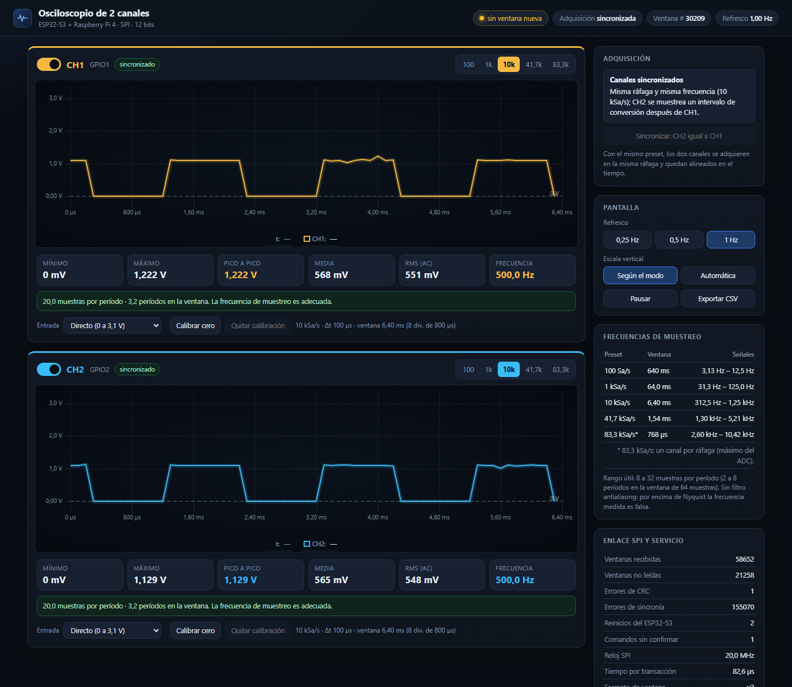
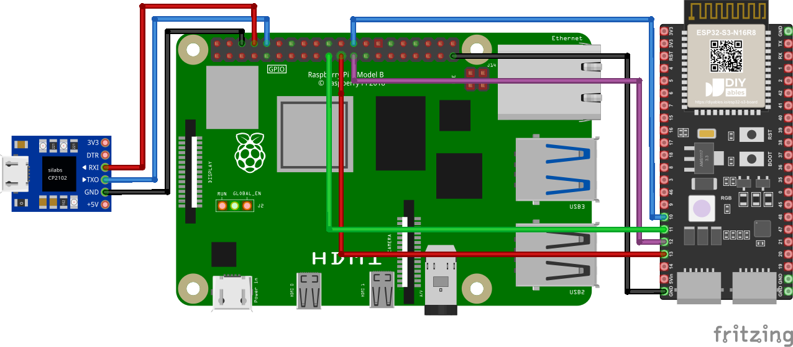

# Proyecto 2 — Sistema híbrido de adquisición analógica por SPI y dashboard embebido (Osciloscopio)

Osciloscopio de **2 canales**: una **ESP32-S3-DevKitC-1** (módulo WROOM-1 N8R2, Zephyr) digitaliza dos señales con su ADC de 12 bits y las entrega por **SPI** (esclavo) a una **Raspberry Pi 4 Model B** (maestro), que las publica en un **dashboard web** servido por **Nginx**. Las ventanas también se ven en el monitor serie del ESP32-S3.

* Ventanas de **64 muestras por canal**, frecuencia de muestreo constante dentro de cada ventana.
* Presets de muestreo intercambiables por SPI: **100, 1 000, 10 000 y 41 667 Sa/s** (este último cumple la bonificación ≥ 40 kSa/s), y **83 333 Sa/s** con un solo canal.
* **Cada canal se enciende y apaga por separado y tiene su propia frecuencia de muestreo.** Con el mismo preset los canales se adquieren sincronizados; con presets distintos, de forma independiente.
* Captura por **refresco de ventanas**: el ESP32-S3 adquiere de forma continua; la Raspberry Pi toma la más reciente.
* Refresco del dashboard configurable entre **0,25 Hz** (4 s) y **1 Hz**.
* Enlace verificado a **20 MHz**: ~586 ventanas/s a 41 667 Sa/s, **0 errores de CRC** en 5 minutos.
* Dashboard: mediciones automáticas (Vmín, Vmáx, Vpp, media, RMS, frecuencia), recomendación de tasa de muestreo, pausa, exportación a CSV y **tensiones negativas** con un acondicionador de entrada.

## Tensiones negativas

El ADC del ESP32-S3 solo mide de 0 a 3,1 V: **nunca conecte una tensión negativa directamente a GPIO1 o GPIO2**. Para señales de ±5 V use por canal este acondicionador y elija en el dashboard el modo «±5 V con acondicionador»:

```
 Vin ──[ R1 = 18 kΩ ]──┬──► GPIO1 / GPIO2 (ADC)
                       ├──[ R2 = 10 kΩ ]── 3V3
                       └──[ R3 = 18 kΩ ]── GND
```

V_ADC = 1,563 V + 0,2632 · Vin (±5 V → 0,25 a 2,88 V). Con la entrada a GND pulse «Calibrar cero» para compensar la tolerancia de las resistencias. Detalle en el Documento 1.

## Frecuencia de muestreo recomendada

| Preset | Ventana | Nyquist | Señales que se ven bien (8 a 32 muestras por período) |
|---|---|---|---|
| 100 Sa/s | 640 ms | 50 Hz | 3 a 12,5 Hz |
| 1 kSa/s | 64 ms | 500 Hz | 31 a 125 Hz |
| 10 kSa/s | 6,4 ms | 5 kHz | 313 Hz a 1,25 kHz |
| 41,7 kSa/s | 1,5 ms | 20,8 kHz | 1,3 a 5,2 kHz |

El dashboard estima la frecuencia de la señal y sugiere el preset adecuado. 41,7 kSa/s es el máximo del ADC con dos canales.



*Dashboard real en la Raspberry Pi: CH1 y CH2 sincronizados a 10 kSa/s con una onda cuadrada de 500 Hz en ambas entradas. En [esta captura](Imagenes/Dashboard_independiente_10k_1k.png) los canales son independientes (10 kSa/s y 1 kSa/s) y CH2 avisa del riesgo de aliasing.*

## Estructura

```
Proyecto_2/
├── Codigo/
│   ├── Firmware_ESP32S3/     Aplicación Zephyr (ADC + DMA, SPI esclavo, monitor serie)
│   │   ├── CMakeLists.txt, prj.conf
│   │   ├── boards/           Overlay de pines/ADC/SPI (+ usb_console.overlay opcional)
│   │   └── src/              main, acq, spi_link, protocol
│   └── Software_RPi/         Servicio oscd (C), dashboard, nginx y systemd
│       ├── src/              oscd.c, spi_master.c, protocol.c
│       ├── web/              index.html + uPlot (local, sin CDN)
│       ├── config/           oscd.service, nginx-osciloscopio.conf
│       ├── tests/            test_protocol.c (sin hardware)
│       ├── Makefile, install.sh
├── Documentos/
│   ├── Latex/                6 documentos LaTeX + preámbulo y portada compartidos + Makefile
│   ├── PDF/                  PDF generados (make en Latex/)
│   ├── IA/                   exportar_chats.ps1 (transcripciones crudas, fuera de Git)
│   └── Resultados_Pruebas/   Evidencias (logs)
└── Imagenes/
```

## Conexiones ESP32-S3-DevKitC-1 ↔ Raspberry Pi 4



*Circuito del sistema (Fritzing). Enlace SPI entre la Raspberry Pi y el ESP32-S3 y adaptador CP2102 para la consola UART de la Raspberry Pi. La pieza de Fritzing es representativa: la placa real es una ESP32-S3-DevKitC-1 con módulo WROOM-1 N8R2. Las entradas CH1 (GPIO1) y CH2 (GPIO2) no aparecen en el dibujo. El GND de la Raspberry Pi puede ir a cualquiera de sus pines GND.*

Pines contados desde arriba, con los conectores USB de la DevKitC-1 hacia abajo.

| Señal | ESP32-S3 | Posición en la DevKitC-1 | Raspberry Pi 4 (pin físico) |
|---|---|---|---|
| CS | GPIO10 | izquierda, pin 16 | GPIO8 / CE0 (24) |
| MOSI | GPIO11 | izquierda, pin 17 | GPIO10 / MOSI (19) |
| SCLK | GPIO12 | izquierda, pin 18 | GPIO11 / SCLK (23) |
| MISO | GPIO13 | izquierda, pin 19 | GPIO9 / MISO (21) |
| GND | GND | izquierda, pin 22 | GND (25) |
| **CH1** (entrada) | **GPIO1** (ADC1_CH0) | derecha, pin 4 | — |
| **CH2** (entrada) | **GPIO2** (ADC1_CH1) | derecha, pin 5 | — |

> En algunos diagramas de pines de la DevKitC-1 las etiquetas genéricas «MISO» y «SCK» están en GPIO12 y GPIO13, al revés del hardware. Lo correcto, según las funciones FSPI, es **SCLK = GPIO12** y **MISO = GPIO13**.

Entradas analógicas: **0 a 3,1 V** (atenuación 12 dB). No superar 3,3 V. Cables SPI cortos y GND común. No conectar entre placas los pines 5V ni 3V3.

## 1. Firmware del ESP32-S3 (WSL + Zephyr)

Requisitos: Zephyr 4.5 con su SDK 1.0.1 y `west` (entorno virtual del workspace).

1. Pasar el puente USB de la placa (CP2102N) a WSL desde PowerShell. `bind` se hace una sola vez y requiere administrador:
   ```
   usbipd list
   usbipd bind --busid <BUSID>
   usbipd attach --wsl --busid <BUSID>
   ```
2. Compilar y cargar desde WSL:
   ```bash
   source ~/zephyrproject/.venv/bin/activate
   cd ~/zephyrproject
   west build -p auto -b esp32s3_devkitc/esp32s3/procpu \
       /ruta/al/repo/Proyecto_2/Codigo/Firmware_ESP32S3 -d ~/build/osc
   west flash -d ~/build/osc --esp-device /dev/ttyUSB1
   ```
   Si hay varios adaptadores, el ESP32-S3 se identifica con `udevadm info -q property -n /dev/ttyUSBx | grep ID_MODEL` (`CP2102N`) o con `esptool --port /dev/ttyUSBx chip-id`.
3. **Monitor serie:** `picocom -b 115200 /dev/ttyUSB1`. Cada segundo imprime una línea `STAT` (canales activos, frecuencia de cada uno, modo sincronizado/independiente) y una línea `WIN` por canal activo. Teclas: **0–4** preset de ambos canales, **q/w** encender/apagar CH1/CH2, **a/s** siguiente preset de CH1/CH2, **d** diagnóstico de la última ráfaga DMA.

La consola es **UART0** (micro-USB «UART» de la placa) a **115200 8N1**. Para usar el puerto USB nativo: `-- -DEXTRA_DTC_OVERLAY_FILE=boards/usb_console.overlay`.

## 2. Software de la Raspberry Pi 4

```bash
cd Proyecto_2/Codigo/Software_RPi
sudo ./install.sh            # paquetes, SPI, nginx, compilación, pruebas, systemd
sudo reboot                  # si SPI acaba de habilitarse
sudo systemctl start oscd    # 20 MHz, guarda de 150 us (config/oscd.service)
```

Abrir `http://<ip-de-la-raspberry>/`. Comandos útiles:

```bash
make test                                                   # pruebas del protocolo (sin hardware)
sudo systemctl stop oscd                                    # liberar el bus antes del banco de pruebas
sudo ./oscd --bench 3000 --preset 3 --speed 20000000 --gap-us 150   # banco de pruebas SPI
curl -X POST 'http://localhost/api/preset?id=2'             # preset de ambos canales (0..4)
curl -X POST 'http://localhost/api/preset?ch=1&id=4'        # preset solo de CH1 (83,3 kSa/s)
curl -X POST 'http://localhost/api/channel?ch=2&on=0'       # apagar CH2 (on=1 lo enciende)
curl -X POST 'http://localhost/api/refresh?hz=0.25'         # cambiar refresco
curl http://localhost/data/window.json                      # última ventana
journalctl -u oscd -f                                       # registro del servicio
```

Parámetros de `oscd`: `--dev`, `--speed` (Hz), `--gap-us` (guarda entre transacciones), `--out`, `--port`, `--refresh` (0,25 a 1), `--preset`, `--bench N`, `--bench-secs S`, `--demo`, `--rt`, `-v`.

**Modo demo (sin ESP32-S3):** `sudo ./oscd --demo --out /run/osciloscopio/window.json --port 8081` genera ventanas sintéticas con el mismo formato.

## 3. Acceso a la Raspberry Pi por UART (USB-UART CP2102)

Consola de mantenimiento, verificada en ambos sentidos con *login* desde el PC.

| CP2102 | Raspberry Pi 4 (pin físico) |
|---|---|
| TX | GPIO15 / RXD (10) |
| RX | GPIO14 / TXD (8) |
| GND | GND (6) |

En la Raspberry Pi: `enable_uart=1`, `dtoverlay=disable-bt` y `serial-getty@ttyAMA0` habilitado (se revierte con `sudo systemctl disable --now serial-getty@ttyAMA0`).

Desde el PC (WSL):
```
usbipd attach --wsl --busid <BUSID del CP2102>      # PowerShell
picocom -b 115200 /dev/ttyUSB0                      # WSL; Enter -> "login:"; salir: Ctrl+A, Ctrl+X
usbipd detach --busid <BUSID>                       # devolver el adaptador a Windows
```
Desde Windows con PuTTY hace falta instalar el driver CP210x de Silicon Labs. Si aparece «Device or resource busy», hay otra terminal (por ejemplo `screen`) abierta sobre el puerto: `screen -r` o `screen -X -S <id> quit`.

## Estado

| Elemento | Estado |
|---|---|
| Firmware en la ESP32-S3-DevKitC-1 (4 presets, ADC con DMA, monitor serie) | Verificado en hardware |
| Enlace SPI ESP32-S3 ↔ Raspberry Pi a 20 MHz, 4 presets, cambio de preset por SPI | Verificado (0 errores de CRC) |
| Estabilidad de 5 min a 41 667 Sa/s (IT-07) | Aprobada |
| Muestreo independiente por canal, encendido/apagado y 83,3 kSa/s (formato v2) | Verificado en hardware |
| Nginx + API + JSON atómico + refresco + reinicio systemd | Verificado en la Raspberry Pi |
| Consola UART de la Raspberry Pi | Verificada |
| Calibración del ADC con señales conocidas (UT-MCU-02) | **Pendiente** |
| Reloj SPI real con analizador lógico (IT-03 a IT-06) | **Pendiente** |
| Dashboard renderizado en un navegador | **Pendiente** |
| Los `.tex` | Revisión estática OK, **sin compilar** (sin LaTeX en el equipo) |

## Documentación

Todos los documentos están en LaTeX en [`Documentos/Latex`](Documentos/Latex/) (ver su README para compilar):

1. Especificación técnica y arquitectura
2. Matriz de verificación y plan de pruebas
3. Protocolo SPI
4. Declaración de participación
5. Declaración de uso de IA
6. Registro de conversaciones
7. **Guía de operación y pruebas manuales** (puesta en marcha paso a paso y 13 pruebas para una persona, con hoja de registro)
