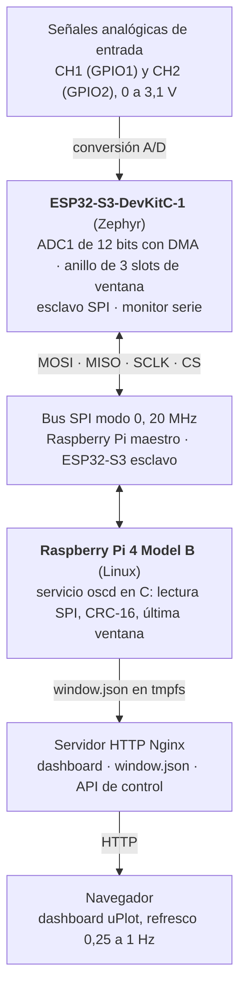
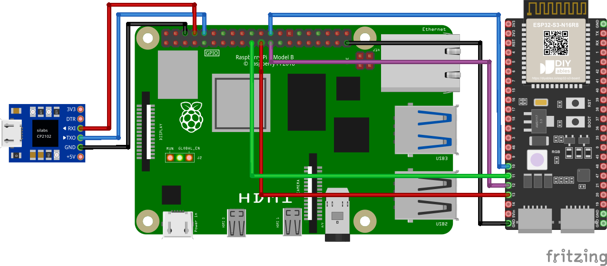
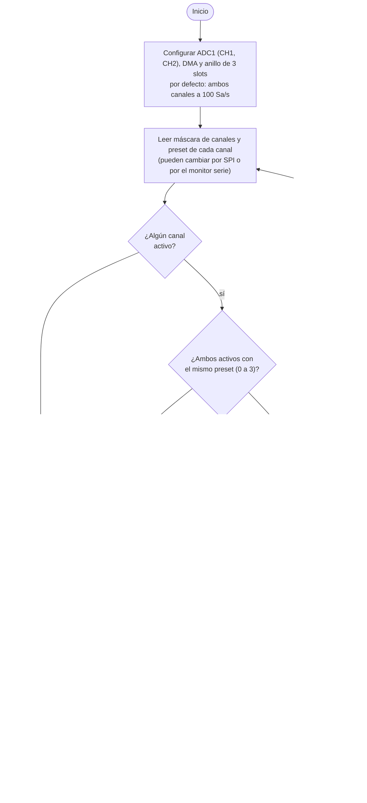
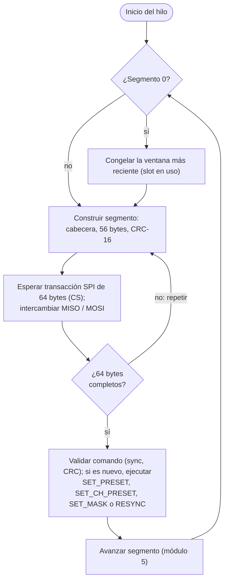
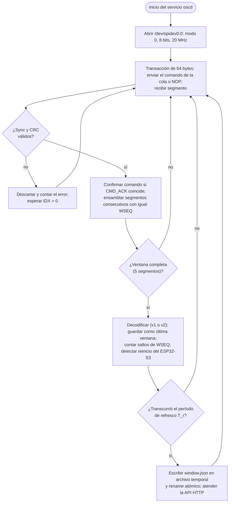

# Documento 1 — Especificación técnica y arquitectura del sistema

**Sistema Híbrido de Adquisición Analógica mediante SPI y Dashboard Embebido en Linux**
Universidad Nacional de Colombia — Sede Manizales · Facultad de Ingeniería y Arquitectura · Ingeniería Electrónica
Materia: *Programación de sistemas Linux embebido* · Manizales, noviembre de 2026

| # | Integrante | C.C. | Rol técnico |
|---|---|---|---|
| 1 | _(completar)_ | _(completar)_ | Ingeniero de Documentación Técnica y Gestión de Configuración |
| 2 | _(completar)_ | _(completar)_ | Arquitecto de Sistemas Embebidos |
| 3 | _(completar)_ | _(completar)_ | Ingeniero de Software y Firmware Embebido |
| 4 | _(completar)_ | _(completar)_ | Ingeniero de Verificación y Validación (V&V) |

**Contenido:** [1. Descripción](#1-descripción-del-proyecto) · [2. Decisiones de diseño](#2-decisiones-de-diseño) · [3. Requerimientos y restricciones](#3-requerimientos-y-restricciones) · [4. Protocolo](#4-protocolo-y-formato-de-trama) · [5. Estimación de la tasa SPI](#5-estimación-teórica-de-la-tasa-de-transferencia-spi) · [6. Diagramas de flujo](#6-diagramas-de-flujo)

---

## 1. Descripción del proyecto

El sistema es un osciloscopio y capturador de datos híbrido de dos canales analógicos. La adquisición se realiza en una placa **ESP32-S3-DevKitC-1** con módulo **ESP32-S3-WROOM-1 N8R2** (8 MB de flash, 2 MB de PSRAM, puente USB-UART CP2102N; datos leídos del chip con `esptool`), programada con **Zephyr RTOS 4.5**. El ESP32-S3 digitaliza ambas señales con el ADC1 de 12 bits, las agrupa en ventanas de 64 muestras por canal y las ofrece por un enlace SPI en el que actúa como esclavo. Una **Raspberry Pi 4 Model B** (Raspberry Pi OS) es el maestro del bus: un servicio escrito en C lee las ventanas, valida su integridad, conserva la última ventana válida y la publica en un servidor HTTP **Nginx**, que sirve un dashboard web con gráficas **uPlot**. Los mismos datos se muestran en el monitor serie del ESP32-S3.

La captura es **por refresco de ventanas**: el ESP32-S3 adquiere ventanas de forma continua y la Raspberry Pi toma la más reciente; no existe captura bajo demanda. La frecuencia de muestreo de cada canal se elige entre presets preconfigurados en el firmware, intercambiables por SPI: 100, 1 000 y 10 000 Sa/s, el preset de bonificación de 41 667 Sa/s y 83 333 Sa/s con un solo canal. Cada canal se puede encender y apagar. El dashboard se actualiza con una tasa entre 0,25 Hz (4 s) y 1 Hz (1 s).

### 1.1 Alcance

- Adquisición de dos canales analógicos con el ADC1 del ESP32-S3 (GPIO1 y GPIO2).
- Ventanas de 64 muestras por canal con temporización constante dentro de cada ventana.
- Transferencia por SPI con la Raspberry Pi como maestro (modo 0) y tramas con CRC-16.
- Cambio de preset y activación de cada canal mediante comandos SPI.
- Servicio `systemd` en la Raspberry Pi que gestiona el bus y almacena la última ventana válida.
- Dashboard web con refresco configurable entre 0,25 Hz y 1 Hz.
- Visualización de las ventanas en el monitor serie del ESP32-S3.

### 1.2 Diagrama de bloques del sistema



### 1.3 Conexiones



*Circuito del sistema (Fritzing): enlace SPI entre la Raspberry Pi 4 y el ESP32-S3, y adaptador CP2102 para la consola UART de la Raspberry Pi. La pieza de Fritzing es representativa; la placa real es una ESP32-S3-DevKitC-1 con módulo WROOM-1 N8R2. Las entradas CH1 (GPIO1) y CH2 (GPIO2) no aparecen en el dibujo; el GND de la Raspberry Pi puede ir a cualquiera de sus pines GND.*

| Señal | ESP32-S3 | Posición en la DevKitC-1 | Raspberry Pi 4 (pin físico) |
|---|---|---|---|
| CS | GPIO10 | Cabecera izquierda, pin 16 | GPIO8 / CE0 (pin 24) |
| MOSI | GPIO11 | Cabecera izquierda, pin 17 | GPIO10 / MOSI (pin 19) |
| SCLK | GPIO12 | Cabecera izquierda, pin 18 | GPIO11 / SCLK (pin 23) |
| MISO | GPIO13 | Cabecera izquierda, pin 19 | GPIO9 / MISO (pin 21) |
| GND | GND | Cabecera izquierda, pin 22 | GND (pin 25) |
| CH1 (entrada) | GPIO1 (ADC1_CH0) | Cabecera derecha, pin 4 | — |
| CH2 (entrada) | GPIO2 (ADC1_CH1) | Cabecera derecha, pin 5 | — |

*Los pines se cuentan desde arriba con los conectores USB hacia abajo. GPIO10 a GPIO13 son los pines nativos (IOMUX) del periférico SPI2 del ESP32-S3.*

**Advertencia sobre diagramas de pines de terceros.** En el diagrama de pines de la DevKitC-1 usado por el equipo, las etiquetas genéricas «MISO» y «SCK» aparecen en GPIO12 y GPIO13, al revés de las funciones del hardware que el mismo diagrama indica en su columna FSPI (FSPICLK en GPIO12 y FSPIQ en GPIO13). Este documento y el firmware siguen las funciones FSPI: **SCLK = GPIO12** y **MISO = GPIO13**.

**Pines que no deben usarse.** GPIO0, GPIO3, GPIO45 y GPIO46 son pines de arranque (*strapping*). GPIO43 y GPIO44 son la consola UART0. GPIO19 y GPIO20 son el USB nativo.

**Rango de las entradas.** Con atenuación de 12 dB el ADC mide de 0 a ≈ 3,1 V (rango útil ≈ 0,1 a 3,1 V; satura entre 3,1 y 3,3 V). **No admite tensiones negativas**: por debajo de unos −0,3 V conducen los diodos de protección del pin y se puede dañar el chip. Las señales fuera de 0 a 3,3 V requieren acondicionamiento externo (sección 2.6).

### 1.4 Acceso de mantenimiento a la Raspberry Pi por UART

Además de SSH, la Raspberry Pi tiene una consola serie de mantenimiento a través de un adaptador USB-UART CP2102, útil cuando la red no está disponible. Se verificó el 5 de noviembre de 2026: se transmitió texto en ambos sentidos y se obtuvo el *login* de la Raspberry Pi desde el PC.

| Adaptador CP2102 | Raspberry Pi 4 (pin físico) |
|---|---|
| TX | GPIO15 / RXD (pin 10) |
| RX | GPIO14 / TXD (pin 8) |
| GND | GND (pin 6) |

*Consola a 115200 8N1 en `ttyAMA0`.* En la Raspberry Pi están activos `enable_uart=1` y `dtoverlay=disable-bt` (el UART PL011 queda en GPIO14 y GPIO15) y el servicio `serial-getty@ttyAMA0`, habilitado de forma permanente; se revierte con `sudo systemctl disable --now serial-getty@ttyAMA0`. En el PC se accede desde WSL (`usbipd attach` y `picocom -b 115200 /dev/ttyUSB0`) o desde Windows con PuTTY, lo que requiere instalar el controlador CP210x de Silicon Labs.

---

## 2. Decisiones de diseño

### 2.1 Adquisición con el ADC del ESP32-S3

El ESP32-S3 tiene un único convertidor SAR por unidad (ADC1) multiplexado entre canales, de modo que **no** es posible muestrear dos canales en el mismo instante. La mejor opción disponible es el **controlador digital del ADC con DMA**: los canales se incluyen en el mismo patrón de conversión y el hardware los convierte uno tras otro con un intervalo constante, sin intervención del procesador. Cuando los dos canales se adquieren juntos, CH2 se muestrea un intervalo de conversión después de CH1; ese desfase es constante y conocido.

El controlador digital admite entre 611 y 83 333 conversiones por segundo (sumando los canales del patrón). Por eso:

- 1 000, 10 000 y 41 667 Sa/s se obtienen con ráfagas DMA de 64 muestras por canal con intervalo constante.
- 100 Sa/s queda por debajo del mínimo de 611 conversiones por segundo y se genera con un temporizador de tick absoluto (sin deriva) de 10 ms que dispara una lectura en cada tick.
- Con dos canales en la misma ráfaga el máximo es 83 333 / 2 ≈ **41 667 Sa/s por canal**, que es el preset de bonificación (cumple ≥ 40 000 Sa/s). Con un solo canal se alcanzan **83 333 Sa/s**.
- Cada ráfaga adquiere una muestra adicional por canal al inicio y la descarta.

| ID | $f_s$ por canal | Modo | Intervalo con 2 canales en ráfaga | Intervalo con 1 canal |
|---|---|---|---|---|
| 0 | 100 Sa/s | Temporizador absoluto | 10 ms | 10 ms |
| 1 | 1 000 Sa/s | Ráfaga DMA | 500 µs | 1 000 µs |
| 2 | 10 000 Sa/s | Ráfaga DMA | 50 µs | 100 µs |
| 3 | 41 667 Sa/s | Ráfaga DMA | 12 µs | 24 µs |
| 4 | 83 333 Sa/s | Ráfaga DMA | no admitido | 12 µs |

*Presets de muestreo del firmware.*

Entre ventanas consecutivas hay un tiempo de arranque de la ráfaga (≈ 75 a 90 µs medidos), por lo que la secuencia de ventanas no es continua en el tiempo; dentro de cada ventana la frecuencia de muestreo es constante. Esto equivale al comportamiento de un osciloscopio que re-arma el disparo en cada barrido.

### 2.2 Muestreo independiente por canal

Cada canal se puede encender o apagar y tiene su propio preset. Como el ADC1 es un único conversor multiplexado, el firmware elige el modo de adquisición en cada ventana:

- **Sincronizado:** ambos canales activos con el mismo preset (0 a 3). Se adquieren en una sola ráfaga con el patrón CH1, CH2, así que sus ventanas están alineadas en el tiempo (CH2 con un desfase de un intervalo de conversión). Es el modo para comparar señales entre sí.
- **Independiente:** presets distintos, o el preset de 83 333 Sa/s con los dos canales. Cada canal se adquiere en su propia ráfaga, uno detrás del otro y a su propia frecuencia. Las ventanas no están alineadas en el tiempo, y el ciclo dura la suma de las dos ventanas.
- **Un canal:** el canal apagado no se adquiere. El otro se refresca más rápido y, sin compartir el conversor, alcanza 83 333 Sa/s (preset 4), el doble del máximo con dos canales.

El formato de la ventana (versión 2, [Documento 3](03_Protocolo_SPI.md)) informa el preset, la frecuencia y el estado de cada canal y si están sincronizados. La Raspberry Pi acepta además el formato anterior (versión 1).

### 2.3 Lenguaje del servicio en la Raspberry Pi

El servicio se implementa en **C**. A 41 667 Sa/s el ESP32-S3 produce una ventana cada ≈ 1,6 ms; el servicio debe realizar cinco transacciones SPI de 64 bytes, validar cinco CRC y ensamblar la ventana en ese tiempo. C con `ioctl(SPI_IOC_MESSAGE)` y temporización con `clock_nanosleep` ofrece latencia acotada y bajo uso de CPU sin depender de un intérprete, lo que da margen para el preset de bonificación. Python con `spidev` no se descartó por medición sino por prudencia de diseño: el requisito de bonificación deja poco margen temporal. La capacidad real del servicio se comprobó con su modo de banco de pruebas (`oscd --bench`): ≈ 586 ventanas/s a 20 MHz ([Documento 2](02_Matriz_verificacion_y_plan_de_pruebas.md)).

### 2.4 Librería de gráficas

El dashboard usa **uPlot**: es una librería MIT de ≈ 50 KB, dibuja en `canvas` con bajo consumo de CPU y se sirve localmente desde la Raspberry Pi, cumpliendo RNF-07 (sin dependencias de servicios externos ni CDN).

### 2.5 Funciones del dashboard

- Un panel por canal con su propia gráfica y eje de tiempo (8 divisiones exactas, línea de 0 V, lectura con cursor), interruptor de encendido y selección de preset propia.
- Escala vertical propia por canal: fija de ±5 V (10 divisiones de 1 V), ±2,5 V, ±1 V o 0 a 3,3 V; automática, que incluye siempre 0 V y los valores negativos; o manual, con mínimo y máximo.
- Modo de entrada: directo, ±5 V con acondicionador o personalizado, con calibración de cero.
- Mediciones por canal: mínimo, máximo, pico a pico, media, RMS de la componente alterna y frecuencia (por cruces con histéresis).
- Recomendación de la frecuencia de muestreo con botón para aplicarla, y botón para sincronizar los canales.
- Refresco, escala de ambos canales, pausa, exportación a CSV y estadísticas del enlace SPI.

### 2.6 Medición de tensiones negativas

El ADC del ESP32-S3 solo convierte tensiones entre 0 y ≈ 3,1 V, y una tensión negativa en GPIO1 o GPIO2 puede dañar el chip. Para observar señales bipolares se antepone a cada canal un **acondicionador resistivo** que atenúa la señal y la desplaza al centro del rango del ADC; el dashboard deshace la transformación y muestra la tensión real de entrada.

```
 Vin ──[ R1 = 18 kΩ ]──┬──► GPIO1 / GPIO2 (ADC)
                       ├──[ R2 = 10 kΩ ]── 3V3
                       └──[ R3 = 18 kΩ ]── GND
```

El nodo que va al ADC se une a la entrada por $R_1$, a 3,3 V por $R_2$ y a GND por $R_3$. Por superposición:

$$V_{ADC} = V_{off} + k\,V_{in},\qquad k = \frac{1/R_1}{1/R_1 + 1/R_2 + 1/R_3},\qquad V_{off} = 3{,}3\ \text{V}\cdot\frac{1/R_2}{1/R_1 + 1/R_2 + 1/R_3}$$

| Parámetro | Valor |
|---|---|
| $R_1$ (entrada), $R_2$ (a 3,3 V), $R_3$ (a GND) | 18 kΩ, 10 kΩ, 18 kΩ |
| Ganancia $k$ | 0,2632 |
| Desplazamiento $V_{off}$ | 1,563 V |
| $V_{in} = +5$ V → $V_{ADC}$ | 2,879 V |
| $V_{in} = -5$ V → $V_{ADC}$ | 0,247 V |
| Impedancia de entrada vista por la señal | $R_1 + R_2 \parallel R_3$ ≈ 24,4 kΩ |
| Impedancia de salida hacia el ADC | $R_1 \parallel R_2 \parallel R_3$ ≈ 4,7 kΩ |

*Acondicionador para el modo ±5 V.*

El dashboard calcula $V_{in} = (V_{ADC} - V_{off} - V_{cal}) / k$. El término $V_{cal}$ lo fija el botón «Calibrar cero» con la entrada del acondicionador unida a GND, y corrige la tolerancia de las resistencias y el error de offset del ADC. Para otros rangos se usa el modo personalizado, introduciendo $V_{off}$ y $k$. La impedancia de entrada de ≈ 24 kΩ carga a fuentes de alta impedancia, lo que debe tenerse en cuenta al medir.

### 2.7 Elección de la frecuencia de muestreo

La frecuencia de muestreo adecuada depende de la señal. Con ventanas de 64 muestras rigen tres criterios:

- **Nyquist:** solo se representan sin *aliasing* señales de frecuencia menor que $f_s/2$.
- **Forma de onda:** para reconocer la forma se necesitan unas 8 muestras por período o más.
- **Duración de la ventana:** para ver al menos 2 períodos completos, $f \geq 2 f_s / 64 = f_s/32$.

| Preset | Ventana | Nyquist ($f_s/2$) | Rango útil ($f_s/32$ a $f_s/8$) |
|---|---|---|---|
| 100 Sa/s | 640 ms | 50 Hz | 3,1 Hz a 12,5 Hz |
| 1 000 Sa/s | 64 ms | 500 Hz | 31 Hz a 125 Hz |
| 10 000 Sa/s | 6,4 ms | 5 kHz | 313 Hz a 1,25 kHz |
| 41 667 Sa/s | 1,536 ms | 20,8 kHz | 1,3 kHz a 5,2 kHz |
| 83 333 Sa/s (un canal) | 768 µs | 41,7 kHz | 2,6 kHz a 10,4 kHz |

Los rangos cubren de forma casi continua de 3 Hz a 10 kHz. El dashboard estima la frecuencia de la señal y recomienda el preset que da entre 8 y 32 muestras por período. El sistema no tiene filtro *antialiasing*: una señal por encima de $f_s/2$ aparece con una frecuencia falsa. Se detecta subiendo la tasa de muestreo: si la frecuencia medida cambia, la anterior era un alias. Para mediciones rigurosas se recomienda un filtro RC paso bajo antes de cada entrada, con frecuencia de corte por debajo de $f_s/2$ del preset en uso.

---

## 3. Requerimientos y restricciones

### 3.1 Requerimientos funcionales

| ID | Requerimiento |
|---|---|
| RF-01 | El ESP32-S3 digitaliza dos canales analógicos (GPIO1 y GPIO2) con el ADC1 de 12 bits. |
| RF-02 | El ESP32-S3 organiza las muestras en ventanas de 64 muestras por canal. |
| RF-03 | El ESP32-S3 muestrea a frecuencia constante, según el preset activo, dentro de cada ventana. |
| RF-04 | Los presets 100, 1 000 y 10 000 Sa/s están preconfigurados en el firmware. |
| RF-05 | El preset de bonificación de 41 667 Sa/s (≥ 40 000 Sa/s) está preconfigurado en el firmware. |
| RF-06 | La Raspberry Pi cambia el preset activo mediante un comando SPI. |
| RF-07 | La Raspberry Pi recupera ventanas completas por SPI y valida su integridad. |
| RF-08 | El servicio en Linux almacena la última ventana válida para el servidor web. |
| RF-09 | El servidor HTTP publica el dashboard y los datos de la última ventana. |
| RF-10 | El dashboard se actualiza con una tasa de refresco configurable entre 0,25 Hz y 1 Hz. |
| RF-11 | Las ventanas adquiridas se muestran en el monitor serie del ESP32-S3. |
| RF-12 | Cada canal se puede encender y apagar, y tiene su propia frecuencia de muestreo (preset). |
| RF-13 | Con un solo canal activo se puede muestrear a 83 333 Sa/s. |

### 3.2 Requerimientos no funcionales

| ID | Requerimiento |
|---|---|
| RNF-01 | El reloj SPI es de 15,6 a 20 MHz (valor de diseño); el valor real lo determinan los divisores del SPI0 de la Raspberry Pi y se mide. |
| RNF-02 | Los bits de una ventana ocupan el bus menos del 15 % del período de ventana en el preset de 41 667 Sa/s. |
| RNF-03 | El firmware usa un anillo de tres slots de ventana para que la adquisición no se detenga durante la transferencia. |
| RNF-04 | El servicio en Linux se ejecuta como servicio `systemd` con reinicio automático. |
| RNF-05 | Cada segmento SPI se valida con CRC-16/CCITT-FALSE. |
| RNF-06 | El ESP32-S3 no reemplaza la ventana que está entregando hasta completar sus cinco segmentos. |
| RNF-07 | El sistema opera en red local sin dependencias de servicios externos. |
| RNF-08 | La escritura de la ventana al servidor web es atómica (archivo temporal y `rename`). |

### 3.3 Restricciones del sistema

| Restricción | Valor de diseño |
|---|---|
| Ventana de captura | $N = 64$ muestras por canal |
| Frecuencias de muestreo | 100, 1 000, 10 000 y 41 667 Sa/s; 83 333 Sa/s con un canal |
| Resolución del ADC | 12 bits (entrada de 0 a 3,1 V con atenuación de 12 dB; sin tensiones negativas) |
| Tasa de refresco del dashboard | $0{,}25\ \text{Hz} \leq f_r \leq 1\ \text{Hz}$ (período de 4 s a 1 s) |
| Modo SPI | Modo 0 (CPOL = 0, CPHA = 0), 8 bits por palabra |
| Tamaño de transacción SPI | 64 bytes (límite del FIFO del esclavo en Zephyr) |
| Tensión lógica | 3,3 V en ambos dispositivos |
| Sistema operativo del SBC | Raspberry Pi OS (Linux) |
| Servidor web | Nginx, configurado como servicio |

---

## 4. Protocolo y formato de trama

El driver del esclavo SPI del ESP32-S3 en Zephyr emplea el FIFO del periférico y limita cada activación de CS a **64 bytes**. Por eso una ventana completa se transmite en **cinco segmentos de 64 bytes**, cada uno en una transacción SPI full duplex: por MISO viaja el segmento de datos y por MOSI un comando de la Raspberry Pi. La especificación completa está en el [Documento 3](03_Protocolo_SPI.md).

| Offset | Bytes | Campo | Descripción |
|---|---|---|---|
| 0 | 1 | SYNC | `0xA5` |
| 1 | 1 | IDX | Índice del segmento (0 a 4); `0xFF` indica que aún no hay ventana |
| 2 | 2 | WSEQ | Contador de ventana (little-endian); sus saltos revelan ventanas no leídas |
| 4 | 1 | PRESET | Preset de CH1 con el que se capturó la ventana |
| 5 | 1 | CMD_ACK | Número del último comando ejecutado |
| 6 | 56 | PAYLOAD | Fragmento IDX del *stream* de la ventana |
| 62 | 2 | CRC16 | CRC-16/CCITT-FALSE de los bytes 0 a 61 |

*Segmento ESP32-S3 → Raspberry Pi (64 bytes).*

El *stream* de la ventana (5 × 56 = 280 bytes, versión 2) contiene un encabezado de 16 bytes (versión, máscara de canales, resolución, banderas, número de muestras y preset y frecuencia de cada canal), 64 muestras de 16 bits de CH1, 64 de CH2 y 8 bytes de relleno.

El comando de la Raspberry Pi (primeros 8 bytes de MOSI) tiene el formato `SYNC=0x5A, CMD, ARG, CMD_SEQ, 2 bytes reservados, CRC16`. Los comandos son NOP, SET_PRESET (ambos canales), RESYNC, SET_CH_PRESET (un canal) y SET_MASK (activar canales). La Raspberry Pi repite el comando hasta ver su número en `CMD_ACK`; el esclavo ignora números repetidos, de modo que la entrega es fiable e idempotente.

Como el esclavo no puede iniciar una transferencia ni avisar que hay un dato disponible, la Raspberry Pi consulta periódicamente. Entre dos transacciones se respeta un tiempo de guarda configurable (150 µs) para que el ESP32-S3 se rearme.

---

## 5. Estimación teórica de la tasa de transferencia SPI

### 5.1 Modelo de la trama

Cada ventana contiene $N = 64$ muestras por canal, $C = 2$ canales y $b_s = 2$ bytes por muestra (la muestra de 12 bits se alinea a 16). En el bus viajan $S = 5$ segmentos de $L = 64$ bytes:

$$B_{datos} = N \cdot C \cdot b_s = 64 \cdot 2 \cdot 2 = 256\ \text{bytes}$$

$$B_{bus} = S \cdot L = 5 \cdot 64 = 320\ \text{bytes} = 2\,560\ \text{bits}$$

### 5.2 Tiempo de transferencia y ciclo de trabajo

El tiempo que ocupan los bits de una ventana a frecuencia de reloj $f_{SPI}$ es:

$$t_{tx} = \frac{B_{bus} \cdot 8}{f_{SPI}} = \frac{2\,560}{f_{SPI}}$$

El período de captura de una ventana a frecuencia de muestreo $f_s$ es $T_w = N / f_s$. El ciclo de trabajo del bus (solo bits de reloj, sin tiempos de guarda) es:

$$D = \frac{t_{tx}}{T_w} = \frac{2\,560\, f_s}{N\, f_{SPI}}$$

La eficiencia del enlace, definida como la fracción de bytes del bus que son datos del ADC, es:

$$\eta = \frac{B_{datos}}{B_{bus}} = \frac{256}{320} = 80\ \%$$

### 5.3 Comparativa por preset

| $f_s$ (Sa/s) | $T_w$ | $t_{tx}$ a 10 MHz | $D$ a 10 MHz | $t_{tx}$ a 20 MHz | $D$ a 20 MHz |
|---|---|---|---|---|---|
| 100 | 640 ms | 256 µs | 0,04 % | 128 µs | 0,02 % |
| 1 000 | 64 ms | 256 µs | 0,40 % | 128 µs | 0,20 % |
| 10 000 | 6,4 ms | 256 µs | 4,0 % | 128 µs | 2,0 % |
| 41 667 | 1,536 ms | 256 µs | 16,7 % | 128 µs | 8,3 % |

*Tiempo de transferencia y ciclo de trabajo del bus SPI por preset (solo bits de reloj).*

El requerimiento RNF-02 ($D < 15\ \%$ a 41 667 Sa/s) se cumple con un reloj de ≈ 11,1 MHz o más, es decir, desde unos 15 MHz solicitados a la Raspberry Pi. A 8 MHz el ciclo de trabajo sería de ≈ 21 %. El reloj efectivo del SPI0 de la Raspberry Pi 4 es un divisor entero del reloj del núcleo del SoC y debe medirse con analizador lógico.

### 5.4 Tasa máxima teórica

Si el bus transmitiera de forma continua, sin tiempos de guarda, la tasa máxima de pares de muestras sería:

$$f_{s,\max} = \frac{N \cdot f_{SPI}}{B_{bus} \cdot 8} = \frac{64 \cdot f_{SPI}}{2\,560} = \frac{f_{SPI}}{40}$$

Con $f_{SPI} = 10$ MHz resulta $f_{s,\max} = 250$ kSa/s, y con 20 MHz, 500 kSa/s. Ambos valores superan con amplio margen el límite del ADC, así que el cuello de botella real no es la tasa de bits del bus sino: (i) el tiempo de guarda entre las cinco transacciones de cada ventana, (ii) la latencia del `ioctl` de `spidev` y (iii) el tiempo de rearme del esclavo. Estas contribuciones se midieron experimentalmente ([Documento 2](02_Matriz_verificacion_y_plan_de_pruebas.md)).

---

## 6. Diagramas de flujo

### 6.1 Firmware del ESP32-S3: hilo de adquisición



### 6.2 Firmware del ESP32-S3: hilo del esclavo SPI



### 6.3 Software en Linux (Raspberry Pi)


