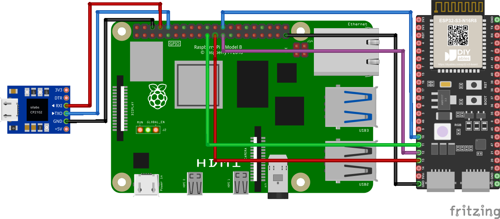
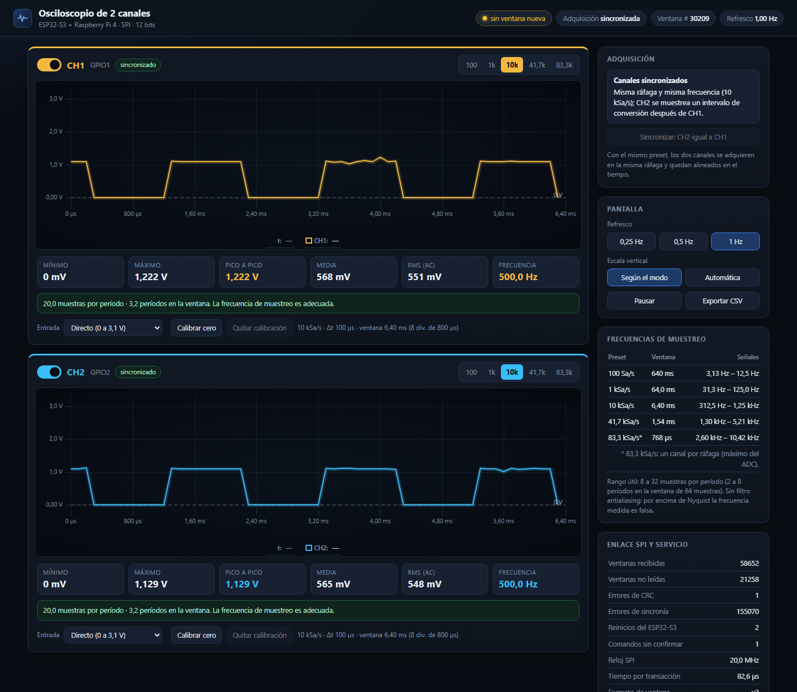

# Proyecto 2 — Osciloscopio: sistema híbrido de adquisición analógica por SPI y dashboard embebido en Linux



*Circuito del sistema: la Raspberry Pi 4 (maestro SPI) lee las ventanas del ESP32-S3 (esclavo SPI) por GPIO10/11/12/13 ↔ pines 24/19/23/21 y GND. El adaptador CP2102 da acceso a la consola UART de la Raspberry Pi. La placa real es una ESP32-S3-DevKitC-1 (WROOM-1 N8R2); las entradas analógicas son CH1 = GPIO1 y CH2 = GPIO2.*

Osciloscopio de **2 canales**: una **ESP32-S3-DevKitC-1** programada con **Zephyr** digitaliza dos señales con su ADC de 12 bits y las entrega por **SPI** a una **Raspberry Pi 4 Model B**, que las publica en un **dashboard web** servido por **Nginx**. Las ventanas también se ven en el monitor serie del ESP32-S3.



*Dashboard real en la Raspberry Pi: CH1 y CH2 sincronizados a 10 kSa/s con una onda cuadrada de 500 Hz. En [esta captura](Imagenes/Dashboard_independiente_10k_1k.png) los canales son independientes (10 kSa/s y 1 kSa/s) y CH2 avisa del riesgo de aliasing.*

## Video del funcionamiento

[](https://youtu.be/xypH554IGnA)

*Haga clic en la imagen para ver el video en YouTube: https://youtu.be/xypH554IGnA*

## Integrantes

| # | Integrante | C.C. | Rol técnico |
|---|---|---|---|
| 1 | Juan Felipe Pachón Restrepo | 1054542918 | Ingeniero de Documentación Técnica y Gestión de Configuración |
| 2 | Juan David Romero Calderón | 1122510542 | Arquitecto de Sistemas Embebidos |
| 3 | Sebastián Tovar Jiménez | 1104939220 | Ingeniero de Software y Firmware Embebido |
| 4 | Juan Pablo Vargas Córdoba | 1076904755 | Ingeniero de Verificación y Validación (V&V) |

Actividades de cada uno en la [declaración de participación](Documentos/04_Declaracion_participacion.md).

## Características

- Ventanas de **64 muestras por canal** con frecuencia de muestreo constante y captura por **refresco de ventanas**.
- Presets intercambiables por SPI: **100, 1 000, 10 000 y 41 667 Sa/s** (bonificación ≥ 40 kSa/s cumplida) y **83 333 Sa/s** con un solo canal.
- **Cada canal se enciende y apaga por separado y tiene su propia frecuencia de muestreo** (modos sincronizado e independiente).
- Enlace SPI a **20 MHz** con tramas CRC-16: ~586 ventanas/s y **0 errores de CRC** en 5 minutos a 41 667 Sa/s.
- Dashboard con refresco de **0,25 a 1 Hz**, escala vertical por canal (±5 V, automática o manual), mediciones automáticas (Vpp, RMS, frecuencia…), recomendación de muestreo, **tensiones negativas** con acondicionador, pausa y exportación a CSV.
- Servicio `systemd` con reinicio automático y recuperación ante reinicios del ESP32-S3.

## Entregables

| Entregable exigido | Dónde está |
|---|---|
| **Repositorio de Git** con documentación, instrucciones de configuración e instalación y códigos fuente | [Instalación, configuración y uso](INSTALACION.md) · [código fuente](Codigo/) · [documentación](Documentos/) |
| **Declaración de participación y aportes** (roles y actividades) | [Documento 4](Documentos/04_Declaracion_participacion.md) |
| **Declaración de uso de IA** (modelo, tareas, verificación, contenido de los chats) | [Documento 5: declaración](Documentos/05_Declaracion_uso_IA.md) · [Documento 6: registro de conversaciones](Documentos/06_Registro_conversaciones.md) |
| **Descripción detallada** con diagramas de bloques y de flujo | [Documento 1](Documentos/01_Especificacion_tecnica_y_arquitectura.md) (secciones 1, 2 y 6) · [Documento 3: protocolo SPI](Documentos/03_Protocolo_SPI.md) |
| **Requerimientos y restricciones** | [Documento 1, sección 3](Documentos/01_Especificacion_tecnica_y_arquitectura.md#3-requerimientos-y-restricciones) |
| **Matriz de verificación** con registro detallado de resultados | [Documento 2](Documentos/02_Matriz_verificacion_y_plan_de_pruebas.md) · [evidencias de las pruebas](Documentos/Resultados_Pruebas/) |
| **Video** del funcionamiento | [Ver en YouTube](https://youtu.be/xypH554IGnA) · [Video/](Video/) |

Toda la documentación está en Markdown y se lee directamente en GitHub, con tablas, ecuaciones y diagramas (Mermaid); no hay que compilar nada.

## Inicio rápido

1. Conectar el SPI como en el circuito: ESP32-S3 GPIO10/11/12/13 ↔ Raspberry Pi pines 24/19/23/21, más GND ([detalle](INSTALACION.md#1-hardware-y-conexiones)).
2. Cargar el firmware desde WSL con `west build` y `west flash` ([sección 2](INSTALACION.md#2-firmware-del-esp32-s3-zephyr-desde-wsl)).
3. En la Raspberry Pi: `sudo ./install.sh` en `Codigo/Software_RPi` ([sección 3](INSTALACION.md#3-software-de-la-raspberry-pi-4)).
4. Abrir `http://<ip-de-la-raspberry>/`.

## Estructura

```
Proyecto_2_Osciloscopio/
├── README.md                 Este archivo: circuito, descripción e índice de entregables
├── INSTALACION.md            Instalación, configuración y uso paso a paso
├── Codigo/
│   ├── Firmware_ESP32S3/     Aplicación Zephyr: ADC + DMA, SPI esclavo, monitor serie
│   │   ├── CMakeLists.txt, prj.conf
│   │   ├── boards/           Overlay de pines, ADC y SPI
│   │   └── src/              main, acq (adquisición), spi_link, protocol
│   └── Software_RPi/         Raspberry Pi 4
│       ├── src/              oscd.c (servicio), spi_master.c, protocol.c
│       ├── web/              Dashboard (index.html + uPlot local)
│       ├── config/           oscd.service (systemd), nginx-osciloscopio.conf
│       ├── tests/            Pruebas unitarias del protocolo
│       └── Makefile, install.sh
├── Documentos/
│   ├── 01 … 06 *.md          Documentos del proyecto (Markdown)
│   └── Resultados_Pruebas/   Evidencias (logs) de cada prueba
├── Imagenes/                 Circuito y capturas del dashboard
└── Video/                    Video del funcionamiento
```

## Estado de la verificación

| Elemento | Estado |
|---|---|
| Firmware en el ESP32-S3: 5 presets, ADC con DMA, monitor serie | Verificado en hardware |
| Enlace SPI a 20 MHz, cambio de preset por SPI, 0 errores de CRC | Verificado |
| Estabilidad de 5 minutos a 41 667 Sa/s (IT-07) | Aprobada |
| Muestreo independiente por canal, encendido/apagado y 83,3 kSa/s (IT-09) | Aprobada |
| Nginx, API, JSON atómico, refresco y reinicio de `systemd` | Verificado en la Raspberry Pi |
| Consola UART de la Raspberry Pi | Verificada |
| Calibración del ADC con señales conocidas (UT-MCU-02) | Pendiente |
| Reloj SPI real con analizador lógico (IT-03 a IT-06) | Pendiente |
| Video del funcionamiento | [Publicado](https://youtu.be/xypH554IGnA) |

Detalle completo en la [matriz de verificación](Documentos/02_Matriz_verificacion_y_plan_de_pruebas.md#2-matriz-de-verificación).

## Plataforma

| Componente | Detalle |
|---|---|
| Microcontrolador | ESP32-S3-DevKitC-1, módulo WROOM-1 N8R2, **Zephyr 4.5** |
| SBC | Raspberry Pi 4 Model B, Raspberry Pi OS, servicio en **C** |
| Web | **Nginx** + dashboard HTML/JS con **uPlot** (sin dependencias externas) |
| Curso | Universidad Nacional de Colombia, sede Manizales — Programación de sistemas Linux embebido |
